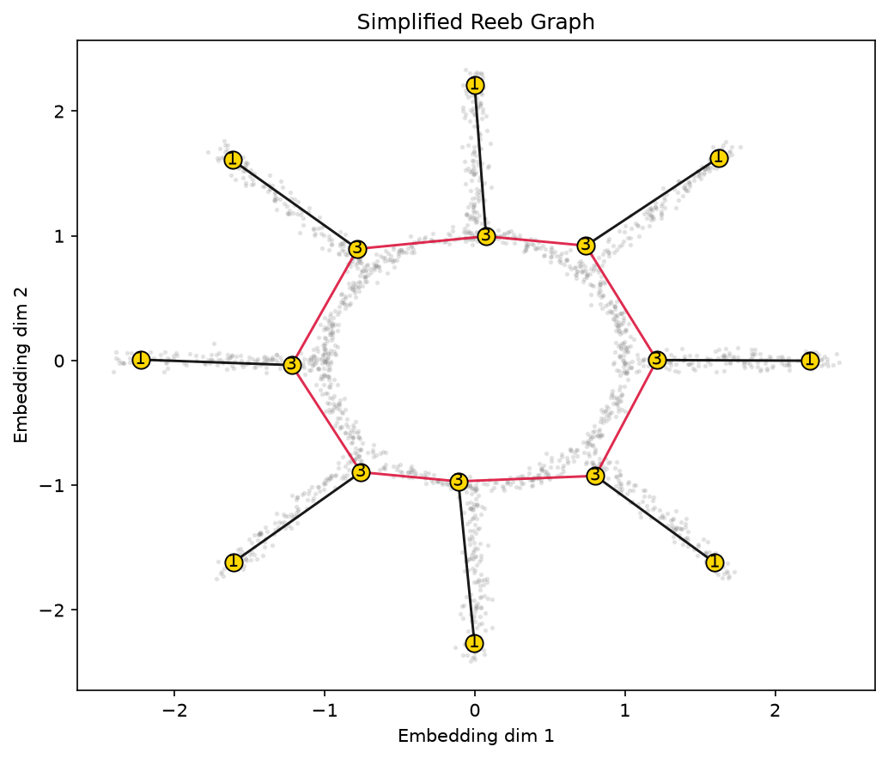

# scReebTower

`scReebTower` builds a discrete Reeb graph from a point cloud or a precomputed
affinity graph. With `scReebTower`, it is possible to create a low dimensional
representation of the shape of a point cloud.



## Installation

Install from GitHub with pip:

```bash
pip install "sc-reeb-tower[plot] @ git+https://github.com/KrishnaswamyLab/scReebTower"
```

The `[plot]` extra installs `matplotlib` and `networkx`, which `plot_scReebTower()`
needs. Drop it for a numerical-only install.

For development, clone the repository and install it in editable mode:

```bash
git clone https://github.com/KrishnaswamyLab/scReebTower
cd scReebTower
pip install -e ".[test]"
pytest
```

## Quickstart

Given a point cloud `X` (an `n_points × n_features` array, with any number of
features) and a 2D or 3D `embedding` of it for plotting:

```python
from sc_reeb_tower import scReebTower, plot_scReebTower

result = scReebTower(X, k=30, return_raw=True, return_intermediates=True)

graph = result["simplified"]
print("nodes:", len(graph["nodes"]))
print("edges:", len(graph["edges"]))
print("loops:", graph["beta1"])

fig, _ = plot_scReebTower(
    pts=embedding,  # 2D or 3D, same row order as X
    simp_edges=graph["edges"],
    keep_ids=graph["keep_ids"],
    reeb_nodes=result["raw"]["nodes"],
    step_vertices=result["intermediates"]["step_vertices"],
    step_comp_ids=result["intermediates"]["step_comp_ids"],
    uniq_v=result["intermediates"]["prep_state"]["uniq_v"],
    color_cycles=True,
    label_degree=True,
)
```

With only `scReebTower(X)`, you get the simplified graph and nothing else. The
`return_*` options add more outputs; here, `return_raw` and
`return_intermediates` provide what the plot needs. You can also pass a
precomputed affinity matrix with `scReebTower(W=...)`, or your own filter with
`filter_values=...`.

The figure above shows the result on the "sun" point cloud from the
[tutorial](notebooks/screebTower_tutorial.ipynb), which yields 16 nodes,
16 edges, and 1 loop.

### High-dimensional data

`scReebTower` works directly on high-dimensional data. Only plotting needs a 
low-dimensional view. `plot_scReebTower()` uses `pts` to place each node at the 
mean position of its points, so `pts` must have 2 or 3 columns, for example a 
PHATE, UMAP, or PCA embedding. Its rows must be in the same order as the rows of 
`X`. If `X` is already 2D or 3D, you can pass `pts=X`.

`scReebTower` does not reduce dimensions itself. For data with very many
features, such as raw gene counts, it is usually better to pass a reduced
representation.

## What else it does

- **Filters:** diffusion eigenfunctions (`diffusion_eigen_index`), rooted
  potential distance, rooted diffusion shortest paths, or a filter you supply.
- **Diffusion smoothing and condensation** before graph construction (`t`,
  `smoothing_mode`, `ell`).
- **Point and edge assignment:** which cells support or belong to each node and
  edge.
- **Cellular decomposition and trajectories:** partition every cell onto graph
  nodes and edges, and enumerate branch-to-branch trajectories.
- **Graph persistence** of the simplified or raw graph.

## Documentation

- [Tutorial notebook](notebooks/screebTower_tutorial.ipynb): torus, hollow
  cylinder, and sun examples, with plots.
- [Common workflows](docs/workflows.md): short recipes for frequent tasks.
- [Options and filters](docs/options.md): every parameter of `scReebTower()`,
  the result structure, and how each filter is built.
- [Assignments, cellular decomposition, and persistence](docs/outputs.md):
  the optional outputs and how they are computed.
- [Plotting](docs/plotting.md): `plot_scReebTower()` and index alignment.
- [`examples/`](examples): grid sanity checks with known answers.
- [`formalization/lean`](formalization/lean): Lean formalization of the
  construction's consistency.

## Citation

<!-- TODO: add the paper reference or a CITATION.cff once available. -->
A citation will be added once the accompanying paper is available.

## License

<!-- TODO: add a LICENSE file and name it here. -->
License to be determined.
